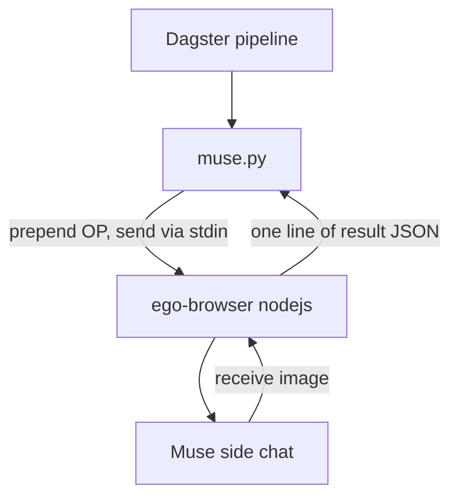

These days I am making narrated videos of yadam (Korean folk tales), set in the late Joseon period. Each episode needs dozens of character illustrations, and I draw them with Muse.

The problem was that I had only ever used Muse through its web UI. One or two images I can make by hand. But keeping the same characters and the same art style across dozens of images per episode meant the pipeline had to call it. So I used ego lite, a browser automation tool, to let a Python pipeline click through the Muse UI for me. The pipeline is written in Python and Dagster, and since the first commit on November 7 it has grown to 186 commits.

## Calling Muse through the browser

The structure is simple. `muse.py` reads the JS driver `muse_driver.js`, prepends a single line `const OP = {...};`, and passes the result to `ego-browser nodejs` over stdin (f900c1b).

```python
script = f"const OP = {json.dumps(op, ensure_ascii=False)};\n" + DRIVER.read_text(encoding="utf-8")
p = subprocess.run(["ego-browser", "nodejs"], input=script, capture_output=True, text=True,
                   check=False, timeout=TIMEOUT[op["op"]])
```

I did not pass values through environment variables because ego lite scripts cannot read shell environment variables. Instead, the values are baked into the first line of the script body.

When the driver finishes, it prints the result JSON as a single last line. Browser-side logs get mixed into stdout too, so Python only reads lines that start with `{"ok":`.

```python
lines = [ln for ln in (p.stdout + p.stderr).splitlines() if ln.startswith('{"ok":')]
```

The driver does four things: open a new chat (`new_chat`), request an image (`generate`), ask about usage (`usage`), and wrap up (`finish`). When an episode starts, it grabs one ego lite TaskSpace (a browser workspace), keeps using it until the episode is done, and then closes it. Chats are opened in a side chat (`muse.ai/thread/new`). There is only one main chat, so I use side chats, which can be opened fresh for each job.



This is what it looks like when it runs. I requested one image of an oil lamp with `uv run python -m yadam.video.muse --smoke`, captured the tab ego lite was driving every 1.5 seconds, and stitched the frames together. About 85 seconds of work is cut down to 16 seconds.


One nice thing: requests sent by the pipeline stay in the side chat list just like conversations a person wrote. When a strange image comes out, I can look at what was sent right there on screen.

## Handling failures by kind

Because the setup clicks a browser on my behalf, it can fail in many ways. Some failures will not go away on retry, like a logged-out session. Others just need another try, like a briefly slow response. To tell them apart I recorded a separate reason for each failure, and added retry rules one commit at a time between November 7 and 10.

| Situation | Handling |
| --- | --- |
| Login screen appears | Fail as "login required", no retry |
| No chat input | Fail as "no chat input" |
| Weekly limit used up | No retry, switch to `state/muse-off` |
| Image does not arrive | Extra retry (81ae36d) |
| Generation failed | Retry in a new chat (b8de51f) |
| Timeout, send failure, no video | Two more tries in a new chat (1272472) |
| Image comes back small | Upscale or fail (257ce2a) |

Separate from these retries, there is a "content retry": if the image does not match the request, I attach notes on what to fix and request it once more.

I set the timeout by adding up the maximum time for each step inside the driver. Page navigation 60 seconds, waiting for the chat input 30, attaching 30, sending 15, waiting for the image 300, settling 20, and downloading 40 add up to 495 seconds. The Python-side `generate` timeout is 540 seconds, longer than that. The driver gets to record a failure reason first, and Python only cuts it off when the driver has hung completely.

### How to recognize a new image

I could not use a count to decide whether an image had arrived. The Muse chat list unloads older images and attaches them again. So from the first version, I remembered the message ids and image URLs at the moment the request was sent, and treated only images that appeared after that as new.

But this could also count images without a message id, like those in the side panel or avatar images, as new. On the same day I narrowed the condition in 20d9c2d. Now it only counts images inside a newly created assistant message with a `naturalWidth` greater than 300.

### Checking the received image

Muse sometimes returns small images like 832x1248. If the short side is under 1000px, I upscale it with LANCZOS. If it is under 750px, I treat it as not worth upscaling and fail.

```python
if min(size) < MIN_SIDE * 0.75:
    raise MuseError(f"그림이 너무 작음 {size[0]}x{size[1]}")
if min(size) < MIN_SIDE:
    k = MIN_SIDE / min(size)
    im = im.resize((round(size[0] * k), round(size[1] * k)), Image.LANCZOS)
```

There was also a problem with half-downloaded webp files left behind after a failure. The next run could pick that file up as a new image, so I made `finally` always delete the temp file (2b9b20e).

Each image request includes the late Joseon setting guide and the character card as is. Commoners wear cotton jeogori (jackets) with trousers or skirts, and yangban (aristocrats) wear a dopo (robe) and a gat (horsehair hat). Married men wear a sangtu (topknot), married women wear their hair in a bun with a binyeo (hairpin), and unmarried people wear braids. The request also says not to include modern objects, Chinese or Japanese clothing, or text in the image.

## Making the images move

Stitching still images together makes for a dull screen. So I added motion in two places.

The first is the hook scene at the start of the video (d90b80e, November 9). The approved hook image is animated with image-to-video. I ask Grok twice first, and the second request includes notes on what to fix from the first result. If both fail or Grok is unavailable, the same sequence repeats with Muse. Once Grok gets blocked by a login, limit, or billing problem, that episode uses only Muse until the end.

The results are filtered by an "eye check". I pull frames at 15%, 40%, 65%, and 95% of the clip and ask a Claude (sonnet) agent whether it is the same character as in the original image. If yes, I use the whole video. If no, I attach notes on what to fix and generate it once more. If it is still wrong, I take only the matching section at the start and play it back and forth slowly. If even that section is too short, I use the still image.

The second is the 5-second character loop (66be1e4, November 10). I take the 12 most-used character images on a green background and turn them into 5-second looping clips with Muse, used as the character layer. But for cuts where the character walks or runs and moves more than 9% of the screen width, I use the still image instead of the loop. It has been on by default since ep06, and in ep09 I laid 15 loop clips across 55 cuts. That took 40.9 minutes. On the day I first tried it, I wrote in a code comment: "Really happy with the loops. Should have done this ages ago."

## Features I noticed while using the UI

Apart from the pipeline, two features stand out when using Muse in the UI.

One is the self-check. After drawing an image, Muse checks the result itself and reports what matched and what was off. When I requested a back view of a character named Yun Deok-gi as "upper body above the knees", it told me up front that the result came out as a full-body shot down to the bare feet. It also pointed out in numbers that the character height was 93.4%, above the 90% target, and that the background corners were values like #02FE05 rather than pure #00FF00. Then it noted that cropping above the knees would cut off the bare feet and the puddle, the core of this scene, and offered three buttons: "Use it full-body, just fix the head", "Redraw as upper body above the knees", and "Use it as is".


The green background gets removed later with chroma key, so the background color and the character size matter. Since Muse reports these two values as numbers first, I can decide right away whether to redraw or use it as is.

The other is Heartbeat. It is a scheduled job that runs every 30 minutes, works through queued requests in order, and records finished ones in the "Today" log. At the start of the week it lays out, as cards, what to decide this week and the order to make things in. Requests from the pipeline land in this log too, so the oil lamp request from the demo above was recorded as "Generate earthen-wall oil lamp image" (3:10 PM).


## Limits and next steps

There are two limits. The free plan's weekly limit fills up fast, and after that I have to use extra tokens. And because it drives the web UI, the driver breaks when the UI changes. The driver depends on selectors like `textarea[placeholder='메시지 보내기']` (the placeholder means "Send a message").

The limit is handled with a single file. When the limit is reached, I put a `state/muse-off` file in place. While that file exists, images are drawn with Gemini, or with Grok Imagine (via ego lite) if that fails, and character loops are skipped. When the limit resets, I delete the file.

I also record the remaining tokens. Before and after a job, I ask Muse how many extra tokens are left as a number, parse answers like `943,215,880`, `943M`, or `9억 4,321만` (the Korean way of writing 943.21 million), and log them to `usage.jsonl` (a1e5163). But Muse only gives values rounded to the M unit, so the ep09 record just says "16M left". I use it to see roughly how much is left, not for exact accounting.

On November 16 I topped up Muse and switched the default order back to Muse first (`muse,grok`).

After that, in late November, I moved image generation, narrator voice, and character motion to local models on a Mac Studio (M2 Max, 32GB). I also ran Wan 2.2 on the Mac Studio instead of an RTX 3090. The details are in the [next post](/en/blog/wan22-mac-studio-mlx/).
