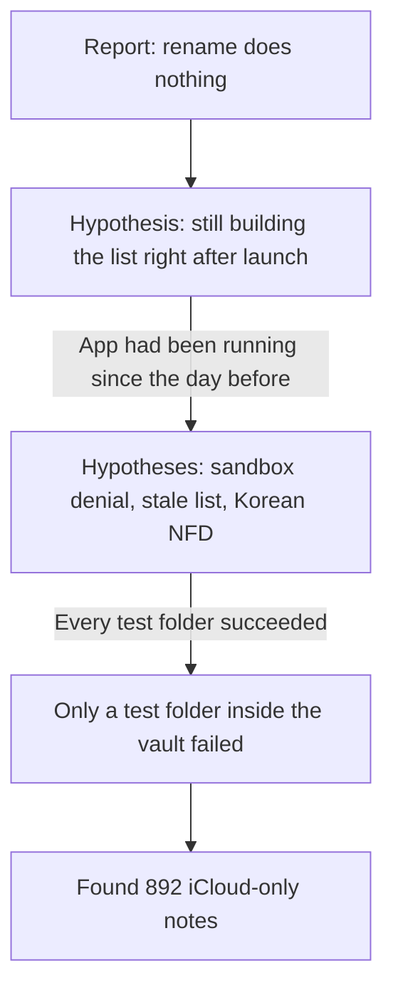

Weaverlet is a Markdown note app for the Mac that I built. It opens the folder you already use as is, and lets you read, search, and edit. I made the first commit on October 24 and submitted 1.0.2 to App Store review on November 14. It is now available for free. As of November 26 there are 487 commits.


## Why I built it

I keep my notes in a single Obsidian vault. It lives in iCloud and holds more than 3,000 notes. After years of use, a few spots in my workflow kept needing manual work.

The biggest one was per-folder sorting. I wanted my meeting notes folder sorted newest first by date, and my guides folder sorted by number prefixes like `01-` and `02-`. I got it working with a plugin, but the config file syntax was fiddly, and when it overlapped with another plugin the sorting was silently ignored. I had also been creating a `00-` entry note in each folder by hand. And my automation scripts sometimes stalled when they read files that had not been downloaded from iCloud yet.

So I wrote this list down as requirements and started building right away. The starting point was to make folder sorting and entry notes built-in features of the file explorer, and to open the vault folder as is, with no import step.

## How the month went

I picked the stack on day one. The app shell is Tauri 2, the UI is TypeScript and React 19, and the editor is CodeMirror 6. Heavy work like file watching, trash, and the search index goes to Rust. I chose Tauri for bundle size and memory.

Search uses the trigram tokenizer in SQLite FTS5. It matches substrings in the middle of words without a Korean morphological analyzer. Queries shorter than 3 characters fall back to a `LIKE` scan. At my vault's size (about 3,000 notes, 25MB), that was enough.


The next day I named the app Weaverlet. At first I also built accounts and settings sync. I added Sign in with Apple next to Google sign-in and deployed an account server. Then, while scoping the first store version, I took accounts out. In a November 11 commit I turned the account feature off by default and pushed it to a future paid version. I narrowed the first version to one job: "open a folder, read, search, and edit."

Here is the timeline.

| Date | What I did |
| --- | --- |
| Oct 24 | First commit, requirements and stack decided |
| Nov 11 | Uploaded the 1.0.0 build to App Store Connect, started TestFlight |
| Nov 12-13 | Investigated the rename bug |
| Nov 14 | Submitted 1.0.2 for review |
| Nov 17 | Designed live preview, 1.0.4 |

## A two-day bug: rename got stuck

While using TestFlight 1.0.0 on my vault, I renamed a note and nothing changed. Folders behaved the same way. The screen sat on "Checking links…" for a long time, and once the status bar showed `I/O error: No such file or directory (os error 2)`. Renaming in Finder showed up in the app right away. One attempt succeeded, which made it more confusing.

When you rename a note, Weaverlet also updates the links that point to it. So I figured the problem was in the link check, not the rename itself. Even so, I threw out four hypotheses before finding the cause.



The first hypothesis was "the app had just launched, so it rejected the rename while building the note list." It worked when I tried again, so I went with that and changed it to wait and then continue (1.0.1). The next day it got stuck again. The status bar message appeared and disappeared too quickly to read. So I read the accessibility tree with agent-desktop and got `No such file or directory`. The app had been running since the previous afternoon, so the first hypothesis was wrong.

Next came sandbox denial, a stale list, and NFD-normalized Korean file names. The vault had 836 NFD Korean names. But when I created NFD files in a test folder and renamed them, it worked. A test folder in iCloud Drive and a test folder inside the same Obsidian iCloud container as the vault all succeeded.

The only failure was a test folder I moved **into** the vault. When I reproduced it myself, it stuck on "Checking links…" with CPU near 0%. It was not computing. It was waiting for something. I counted the file flags on the notes.

```bash
stat -f %Sf <note file>
# compressed,dataless
```

There were 892 `dataless` notes. These are files whose contents iCloud's "Optimize Mac Storage" had offloaded. While I waited, 892 dropped to 758, then to 0, and once they were gone the rename went through.

The cause was a Rust function that finds notes needing link updates. It read **every** note in the vault. The moment you read a dataless file, macOS downloads it from iCloud. Downloading 892 of them one by one stalled the app for minutes. My test folders held freshly created files that were all on this Mac, so nothing reproduced wherever I tested. The problem was not the vault size but the number of notes in the vault that had not been downloaded yet.

Here is the fix in 1.0.2. It checks `SF_DATALESS` in the file's `st_flags` and does not read iCloud-only notes directly. It first filters candidates using the body text stored in the search index (SQLite FTS). It trusts that text only when the modification time and size recorded at indexing match the current file. It reads only the notes that actually contain the name being changed, so only those few get downloaded. Notes not in the index are not downloaded and are reported as "n notes could not be read."

I took away two things. In an iCloud vault, "read every note" is not free. Any feature that walks the whole vault, like listing, search, and links, has to handle dataless files separately. And when something won't reproduce, start by checking what differs between the test environment and the real one. This time the difference was whether the files were downloaded.

## What I learned preparing for App Store review

Review prep had more small chores than I expected. I needed two certificates: Apple Distribution and Mac Installer Distribution. The store-signed build does not run directly on my Mac, so I verified it through TestFlight. I submitted the privacy label as "Data Not Collected." The store build has no accounts, no sync, and no update check, so I could fill it in as is.

The TestFlight internal testing invite email never arrived. My App Store account and my App Store Connect account were different, so the internal build did not show up. I switched to a public link, and beta review passed within a day. From the beta feedback, I added "open a file by drag and drop" in 1.0.1.

Some things came up right before submission. My review notes told the reviewer to "click Open Sample Folder on first launch," but the app had no such button. I attached the example folder as a zip and changed the note to "unzip the attached folder and open it." The content rights value would not save in the web UI, and "Sign-in required" was turned on in the review information. I found both by reading the API error messages.


## What's next

I added live preview to the next update, 1.0.4, and submitted it for review. Only the line being edited shows raw text, and the other lines show the rendered result. Code review turned up a problem where typing Korean right after opening a note could garble the first character, so I fixed it by redrawing that line on the first keystroke.

Accounts, note sync, and collaboration stay out of the first version. I will decide on the next features based on user feedback.

Weaverlet is free and collects nothing. It supports 13 languages. You can get to the App Store from the landing page.

- Landing page: [qn51z.com/weaverlet](https://qn51z.com/weaverlet/)
