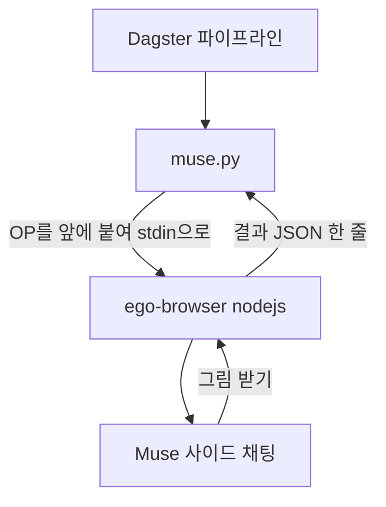

요즘 조선 후기를 배경으로 한 옛날이야기(야담) 낭독 영상을 만들고 있다. 편마다 인물 삽화가 수십 장 들어가는데, 그림은 Muse로 그린다.

문제는 내가 Muse를 웹 화면으로만 써 왔다는 점이었다. 한두 장이면 손으로 그려도 되지만, 편마다 수십 장을 같은 인물과 같은 화풍으로 맞추려면 파이프라인에서 불러야 했다. 그래서 브라우저 조작 도구인 ego lite로 Python 파이프라인이 Muse 화면을 대신 누르게 만들었다. 파이프라인은 Python과 Dagster로 짰고, 11월 7일 첫 커밋 뒤로 커밋이 186개 쌓였다.

## 브라우저로 Muse 부르기

구조는 단순하다. `muse.py`가 JS 드라이버 `muse_driver.js`를 읽고, 맨 앞에 `const OP = {...};` 한 줄을 붙여서 `ego-browser nodejs`의 stdin으로 넘긴다(f900c1b).

```python
script = f"const OP = {json.dumps(op, ensure_ascii=False)};\n" + DRIVER.read_text(encoding="utf-8")
p = subprocess.run(["ego-browser", "nodejs"], input=script, capture_output=True, text=True,
                   check=False, timeout=TIMEOUT[op["op"]])
```

값을 환경변수로 넘기지 않은 건 ego lite 스크립트가 셸 환경변수를 받지 못해서다. 대신 스크립트 본문 첫 줄에 값을 박아 넣는다.

드라이버는 일이 끝나면 결과 JSON을 마지막 줄에 한 줄로 찍는다. stdout에는 브라우저 쪽 로그도 섞여 나오기 때문에, Python은 `{"ok":`로 시작하는 줄만 골라 읽는다.

```python
lines = [ln for ln in (p.stdout + p.stderr).splitlines() if ln.startswith('{"ok":')]
```

드라이버가 하는 일은 새 대화 열기(`new_chat`), 그림 요청(`generate`), 사용량 묻기(`usage`), 마무리(`finish`) 네 가지다. 편 하나를 시작하면 ego lite의 TaskSpace(브라우저 작업 공간)를 하나 잡아 편이 끝날 때까지 이어 쓰고, 끝나면 닫는다. 대화는 사이드 채팅(`muse.ai/thread/new`)에서 연다. 기본 채팅은 하나뿐이라 작업마다 새로 열 수 있는 사이드 채팅을 쓴다.



실제로 돌리면 이렇게 보인다. `uv run python -m yadam.video.muse --smoke`로 등잔 그림 한 장을 요청하고, ego lite가 조작하는 탭을 1.5초마다 찍어 이었다. 약 85초 걸린 과정을 16초로 줄였다.


좋은 점이 하나 있다. 파이프라인이 보낸 요청도 사람이 쓴 대화처럼 사이드 채팅 목록에 남는다. 이상한 그림이 나오면 무엇을 보냈는지 화면에서 바로 다시 볼 수 있다.

## 실패를 나눠서 처리하기

브라우저를 대신 누르는 구조라 실패하는 방식이 여러 가지다. 로그인이 풀린 경우처럼 다시 해도 소용없는 실패가 있고, 잠깐 응답이 늦은 경우처럼 다시 하면 되는 실패가 있다. 둘을 구분하려고 실패마다 이유를 따로 남겼고, 재시도 규칙은 11월 7일부터 10일 사이에 커밋으로 하나씩 더했다.

| 상황 | 처리 |
| --- | --- |
| 로그인 화면이 뜸 | "로그인 필요"로 실패, 재시도 안 함 |
| 채팅창이 없음 | "채팅창 없음"으로 실패 |
| 주간 한도 소진 | 재시도 안 함, `state/muse-off`로 전환 |
| 그림이 안 옴 | 추가 재시도 (81ae36d) |
| 생성 실패 | 새 채팅에서 다시 (b8de51f) |
| 타임아웃, 보내기 실패, 영상 없음 | 새 채팅에서 두 번 더 (1272472) |
| 그림이 작게 옴 | 키우거나 실패 (257ce2a) |

이 재시도와 별개로, 그림 내용이 요청과 어긋나면 고칠 점을 붙여 한 번 더 요청하는 "내용 재시도"가 있다.

타임아웃은 드라이버 안 단계별 최대 시간을 더해서 정했다. 페이지 이동 60초, 채팅창 대기 30초, 첨부 30초, 보내기 15초, 그림 대기 300초, 안정화 20초, 받기 40초를 더하면 495초다. Python 쪽 `generate` 타임아웃은 이보다 긴 540초로 뒀다. 드라이버가 먼저 실패 이유를 남기게 하고, Python은 드라이버가 아예 멈췄을 때만 끊는다.

### 새 그림은 어떻게 알아보나

그림이 도착했는지 판단하는 데는 개수를 쓸 수 없었다. Muse 채팅 목록은 지난 그림을 내렸다가 다시 붙이기 때문이다. 그래서 첫 버전부터 요청을 보낸 시점의 메시지 id와 그림 주소를 기억해 두고, 그 뒤에 나온 그림만 새 그림으로 봤다.

그런데 이 방식은 메시지 id가 없는 그림, 예를 들어 옆 패널이나 아바타 그림까지 새 그림으로 셀 수 있었다. 같은 날 20d9c2d에서 조건을 좁혔다. 지금은 새로 생긴 assistant 메시지 안에 있고, `naturalWidth`가 300보다 큰 그림만 센다.

### 받은 그림 검사

Muse는 가끔 832x1248처럼 작은 그림을 준다. 짧은 변이 1000px보다 작으면 LANCZOS로 키우고, 750px도 안 되면 키워 쓸 수준이 아니라고 보고 실패로 처리한다.

```python
if min(size) < MIN_SIDE * 0.75:
    raise MuseError(f"그림이 너무 작음 {size[0]}x{size[1]}")
if min(size) < MIN_SIDE:
    k = MIN_SIDE / min(size)
    im = im.resize((round(size[0] * k), round(size[1] * k)), Image.LANCZOS)
```

실패했을 때 받다 만 webp 파일이 남는 문제도 있었다. 다음 실행이 그 파일을 새 그림으로 집어 갈 수 있어서, `finally`에서 임시 파일을 항상 지우게 했다(2b9b20e).

그림 요청에는 조선 후기 설정집과 인물 카드를 그대로 붙여 보낸다. 서민은 무명 저고리와 바지·치마, 양반은 도포에 갓을 쓴다. 기혼 남자는 상투, 기혼 여자는 쪽진 머리에 비녀, 미혼은 땋은 머리다. 현대 물건, 중국·일본식 옷차림, 화면 안 글자는 넣지 말라고 적는다.

## 그림을 움직이기

정지 그림만 이어 붙이면 화면이 심심하다. 그래서 두 군데에 움직임을 넣었다.

첫 번째는 영상 첫머리의 후킹 장면이다(d90b80e, 11월 9일). 승인된 후킹 그림을 image-to-video로 움직이는데, Grok에 먼저 두 번 요청하고 두 번째에는 첫 결과의 고칠 점을 붙인다. 둘 다 실패하거나 Grok을 쓸 수 없으면 Muse로 같은 순서를 반복한다. Grok이 로그인·한도·결제 문제로 한 번 막히면 그 편은 끝까지 Muse만 쓴다.

결과는 "눈 검사"로 거른다. 클립의 15%, 40%, 65%, 95% 지점 프레임을 뽑아서 Claude(sonnet) 에이전트에게 원래 그림과 같은 인물인지 묻는다. 맞으면 영상을 다 쓰고, 틀리면 고칠 점을 붙여 한 번 더 만든다. 그래도 틀리면 앞쪽에서 맞는 구간만 느리게 왕복시키고, 그 구간마저 너무 짧으면 그림을 그대로 쓴다.

두 번째는 인물 5초 루프다(66be1e4, 11월 10일). 초록 배경 인물 그림 중 가장 많이 쓰는 12장을 Muse로 5초짜리 반복 클립으로 만들어 인물 레이어로 쓴다. 다만 인물이 걷거나 뛰어서 화면 폭의 9% 넘게 움직이는 컷은 루프 대신 그림을 쓴다. ep06부터 기본으로 켰고, ep09에서는 루프 클립 15개를 55컷에 깔았다. 이 작업에 40.9분이 걸렸다. 처음 시험해 본 날 코드 주석에는 "루프 아주 만족스럽다. 진즉 이렇게 할걸."이라고 적어 뒀다.

## 화면에서 쓰면서 눈에 띈 기능

파이프라인과 별개로, 화면에서 Muse를 쓰다 보면 눈에 띄는 기능이 두 가지 있다.

하나는 자체 점검이다. Muse는 그림을 그린 뒤 결과를 스스로 점검해서 맞은 점과 어긋난 점을 나눠 보고한다. 윤덕기라는 인물의 뒷모습을 "무릎 위 상반신"으로 요청했을 때는 맨발까지 보이는 전신으로 나왔다고 먼저 알려 왔다. 인물 높이가 93.4%로 목표 90%보다 크고, 배경 모서리가 순수 #00FF00이 아니라 #02FE05 같은 값이라는 것도 숫자로 짚었다. 그러고는 무릎 위로 자르면 이 장면의 핵심인 맨발과 물웅덩이가 잘린다며 "전신으로 쓸게, 고개만 고쳐줘", "무릎 위 상반신으로 다시 그려줘", "이대로 쓸게" 세 버튼을 줬다.


초록 배경은 나중에 크로마키로 지우기 때문에 배경색과 인물 크기가 중요하다. 이 두 값을 Muse가 먼저 숫자로 알려 주니 다시 그릴지 그대로 쓸지를 바로 정할 수 있다.

다른 하나는 Heartbeat다. 30분마다 도는 예약 작업인데, 쌓인 요청을 순서대로 처리하고 끝난 것은 "오늘" 로그에 남긴다. 주 초에는 이번 주에 정할 것과 만들 순서를 카드로 정리해 준다. 파이프라인이 보낸 요청도 이 로그에 같이 남아서, 위 데모의 등잔 요청은 "흙벽 등잔 이미지 생성"(오후 3:10)으로 기록됐다.


## 한계와 다음 단계

한계는 두 가지다. 무료 플랜의 주간 한도가 금방 차고, 그다음부터는 추가 토큰으로 써야 한다. 그리고 웹 화면을 조작하는 구조라서 화면이 바뀌면 드라이버가 깨진다. 드라이버가 `textarea[placeholder='메시지 보내기']` 같은 셀렉터에 기대고 있어서다.

한도는 파일 하나로 다룬다. 한도가 차면 `state/muse-off` 파일을 둔다. 이 파일이 있으면 그림은 Gemini로, 안 되면 Grok Imagine(ego lite)으로 그리고, 인물 루프는 건너뛴다. 한도가 풀리면 파일을 지운다.

남은 토큰도 기록한다. 작업 전후로 Muse에게 추가 토큰이 몇 개 남았는지 숫자로 묻고, `943,215,880`, `943M`, `9억 4,321만` 같은 답을 파싱해서 `usage.jsonl`에 남긴다(a1e5163). 다만 Muse는 M 단위로 반올림한 값만 알려 줘서, ep09 기록에는 "16M 남음"이라고만 남았다. 정확한 계산보다는 대략 얼마나 남았는지 보는 데 쓴다.

11월 16일에 Muse를 충전하면서 기본 순서를 다시 Muse 먼저(`muse,grok`)로 돌렸다.

다음으로는 RTX 3090에 ComfyUI와 Wan 2.2를 올려서 인물 루프를 로컬에서 만드는 방법을 보고 있다. 아직 해 보지는 않았다. 한도와 브라우저 의존에서 벗어날 수 있는지 확인하려는 단계다.
