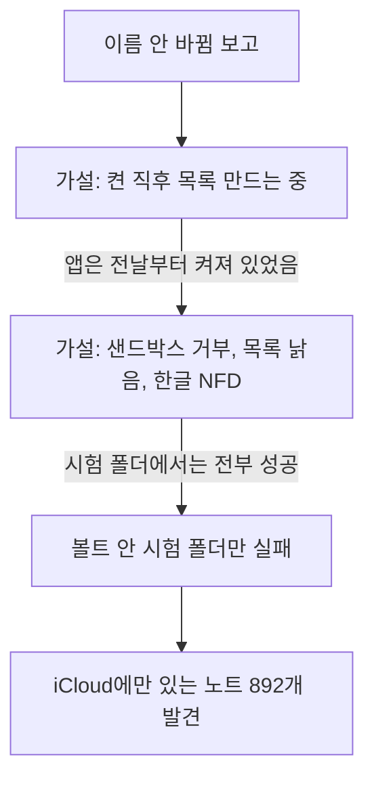

Weaverlet은 내가 만든 Mac용 Markdown 노트 앱이다. 이미 쓰고 있는 폴더를 그대로 열어서 읽고, 찾고, 고친다. 10월 24일에 첫 커밋을 했고 11월 14일에 1.0.2를 App Store 심사에 냈다. 지금은 무료로 공개 중이다. 11월 26일까지 커밋은 487개다.


## 왜 만들었나

나는 노트를 Obsidian 볼트 하나에 모은다. iCloud에 있고, 노트가 3천 개를 넘는다. 오래 쓰다 보니 내 쓰임새에서 계속 손이 가는 곳이 생겼다.

가장 컸던 건 폴더별 정렬이다. 회의록 폴더는 날짜 최신순, 가이드 폴더는 `01-`, `02-` 번호순으로 보고 싶었다. 플러그인으로 맞췄지만 설정 파일 문법이 까다로웠고, 다른 플러그인과 겹치자 정렬이 조용히 무시됐다. 폴더마다 `00-` 입구 노트도 손으로 만들어 왔다. iCloud에서 아직 내려받지 않은 파일을 읽으면 자동화 스크립트가 멈추는 일도 있었다.

그래서 이 목록을 요구사항으로 적고 바로 만들기 시작했다. 폴더 정렬과 입구 노트를 탐색기 기본 기능으로 넣고, 볼트 폴더는 가져오기 없이 그대로 여는 것이 출발점이었다.

## 한 달의 흐름

스택은 첫날 정했다. 앱 셸은 Tauri 2, 화면은 TypeScript와 React 19, 에디터는 CodeMirror 6다. 파일 감시, 휴지통, 검색 색인처럼 무거운 일은 Rust에 맡겼다. Tauri를 고른 건 배포 용량과 메모리 때문이다.

검색은 SQLite FTS5의 trigram tokenizer를 쓴다. 한국어 형태소 분석기 없이도 단어 중간의 부분 문자열이 잡힌다. 3글자보다 짧은 검색어는 `LIKE`로 훑는다. 내 볼트 규모(약 3천 개, 25MB)에서는 이걸로 충분했다.


다음 날 앱 이름을 Weaverlet으로 정했다. 처음에는 계정과 설정 동기화도 만들었다. Google 로그인 옆에 Sign in with Apple을 붙이고 계정 서버도 배포했다. 그런데 첫 스토어 버전 범위를 정리하면서 계정을 뺐다. 11월 11일 커밋에서 계정 기능을 기본으로 꺼 두고, 나중 유료판으로 미뤘다. 첫 버전이 할 일은 "폴더를 열어 읽고, 찾고, 고친다" 하나로 좁혔다.

날짜로 보면 이렇다.

| 날짜 | 한 일 |
| --- | --- |
| 10월 24일 | 첫 커밋, 요구사항과 스택 결정 |
| 11월 11일 | 1.0.0 빌드를 App Store Connect에 업로드, TestFlight 시작 |
| 11월 12~13일 | 이름 바꾸기 버그 조사 |
| 11월 14일 | 1.0.2 심사 제출 |
| 11월 17일 | 실시간 미리보기 설계, 1.0.4 |

## 이틀 걸린 버그: 이름 바꾸기가 멈췄다

TestFlight 1.0.0을 내 볼트에서 쓰다가 노트 이름을 바꿨는데 바뀌지 않았다. 폴더도 마찬가지였다. 화면은 "링크를 확인하는 중…"에서 오래 멈췄고, 한 번은 상태 막대에 `I/O 오류: No such file or directory (os error 2)`가 떴다. Finder에서 바꾸면 앱에 바로 반영됐다. 한 번은 성공해서 더 헷갈렸다.

이름을 바꾸면 Weaverlet은 그 노트를 가리키는 링크도 같이 고친다. 그래서 문제는 이름 바꾸기 자체보다 링크 확인 쪽에 있다고 봤다. 그래도 원인을 찾기까지 가설 네 개를 버렸다.



첫 가설은 "앱을 켠 직후라 노트 목록을 만드는 중이라 거부했다"였다. 다시 해 보니 성공해서 그렇게 판단하고 기다렸다 이어서 하도록 고쳤다(1.0.1). 다음 날 또 멈췄다. 상태 막대 문구는 잠깐 떴다 사라져서 눈으로 못 읽었다. 그래서 agent-desktop으로 접근성 트리를 읽어 `No such file or directory`를 얻었다. 앱은 전날 오후부터 켜져 있었으니 첫 가설은 틀렸다.

다음은 샌드박스 거부, 목록이 낡음, 한글 파일명 NFD였다. 볼트에는 NFD 한글 이름이 836개 있었다. 그런데 시험 폴더에 NFD 파일을 만들어 바꿔 보니 잘 됐다. iCloud Drive 시험 폴더도, 볼트와 같은 Obsidian iCloud 컨테이너 안의 시험 폴더도 전부 성공했다.

실패한 건 볼트 **안으로** 옮긴 시험 폴더뿐이었다. 직접 재현하니 "링크를 확인하는 중…"에서 멈췄고 CPU는 거의 0%였다. 계산이 아니라 무언가를 기다리고 있었다. 노트 파일 플래그를 세어 봤다.

```bash
stat -f %Sf <노트 파일>
# compressed,dataless
```

`dataless` 노트가 892개 있었다. iCloud의 "Mac 저장 공간 최적화"가 내용을 내려 둔 파일이다. 기다리는 동안 892개가 758개, 0개로 줄었고, 다 줄자 이름이 바뀌었다.

원인은 링크를 고칠 노트를 찾는 Rust 함수가 볼트의 노트를 **전부** 읽은 데 있었다. dataless 파일은 읽는 순간 macOS가 iCloud에서 내려받는다. 892개를 차례로 받느라 몇 분씩 멈췄다. 시험 폴더는 방금 만든 파일이라 전부 이 Mac에 있었고, 그래서 어디서 시험해도 재현되지 않았다. 볼트 크기가 아니라 볼트 안에서 아직 내려받지 않은 노트 수가 문제였다.

1.0.2에서 이렇게 고쳤다. 파일의 `st_flags`에서 `SF_DATALESS`를 보고, iCloud에만 있는 노트는 바로 읽지 않는다. 먼저 검색 색인(SQLite FTS)에 남아 있는 본문으로 후보를 거른다. 색인 때의 수정 시각과 크기가 지금과 같을 때만 그 본문을 믿는다. 찾는 이름이 실제로 들어 있는 노트만 읽으니 내려받는 파일도 그 몇 개뿐이다. 색인에 없는 노트는 내려받지 않고 "못 읽은 노트 n개"로 알린다.

배운 건 두 가지다. iCloud 볼트에서 "모든 노트 읽기"는 공짜가 아니다. 목록, 검색, 링크처럼 볼트 전체를 도는 기능은 dataless 파일을 따로 다뤄야 한다. 그리고 재현이 안 되면 시험 환경과 실제 환경이 무엇이 다른지부터 본다. 이번에는 파일이 내려받아져 있는지가 그 차이였다.

## App Store 심사 준비에서 배운 것

심사 준비는 생각보다 자잘한 일이 많았다. 인증서는 Apple Distribution과 Mac Installer Distribution 두 가지가 필요했다. 스토어 서명 빌드는 내 Mac에서 바로 실행되지 않아서 확인은 TestFlight로 했다. 개인정보 라벨은 "수집 없음"으로 냈다. 스토어 빌드에는 계정도, 동기화도, 업데이트 확인도 없어서 그대로 적으면 됐다.

TestFlight 내부 테스트 초대 메일은 오지 않았다. 내 App Store 계정과 App Store Connect 계정이 달라서 내부 빌드가 보이지 않았다. 그래서 공개 링크로 돌렸고, 베타 심사는 하루 안에 통과했다. 베타에서 받은 피드백 중 "파일을 끌어다 놓아 열기"는 1.0.1에 넣었다.

제출 직전에 걸린 것도 있다. 심사 노트에 "첫 실행에서 샘플 폴더 열기를 누르라"고 적어 두었는데, 정작 앱에는 그 버튼이 없었다. 예제 폴더를 zip으로 첨부하고 노트를 "첨부 폴더를 풀어서 열라"로 바꿨다. 콘텐츠 권한 값은 웹 화면에서 저장이 안 됐고, 심사 정보의 "로그인 필요"가 켜져 있었다. 둘 다 API 오류 메시지를 읽고 찾았다.


## 다음 계획

다음 업데이트인 1.0.4에는 실시간 미리보기를 넣어 심사에 냈다. 편집하는 줄만 원문으로 보이고 나머지 줄은 렌더된 모양으로 보인다. 리뷰에서 노트를 열자마자 한글을 치면 첫 글자가 깨질 수 있는 문제가 나왔고, 첫 키 입력에서 그 줄을 다시 그리도록 고쳤다.

계정, 노트 동기화, 협업은 첫 버전에서 뺀 채로 두었다. 다음 기능은 사용자 피드백을 보고 정한다.

Weaverlet은 무료이고 아무것도 수집하지 않는다. 지원 언어는 13개다. 소개 페이지에서 App Store로 갈 수 있다.

- 소개 페이지: [qn51z.com/weaverlet](https://qn51z.com/weaverlet/)
